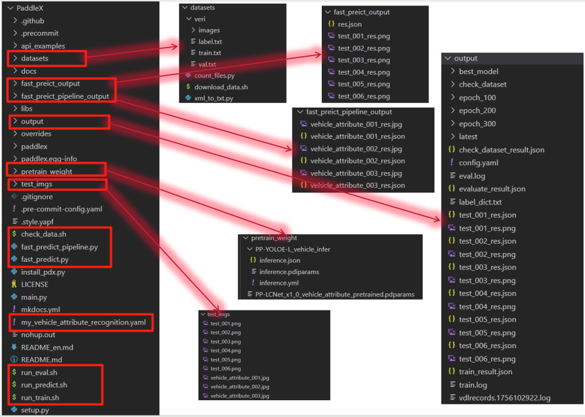
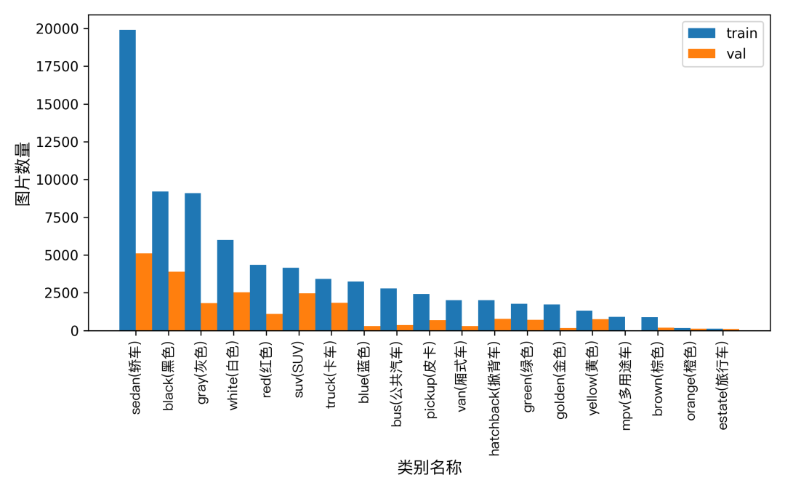
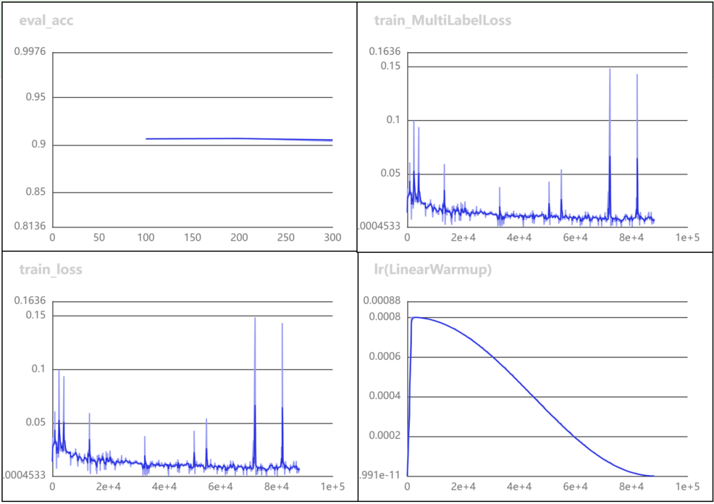
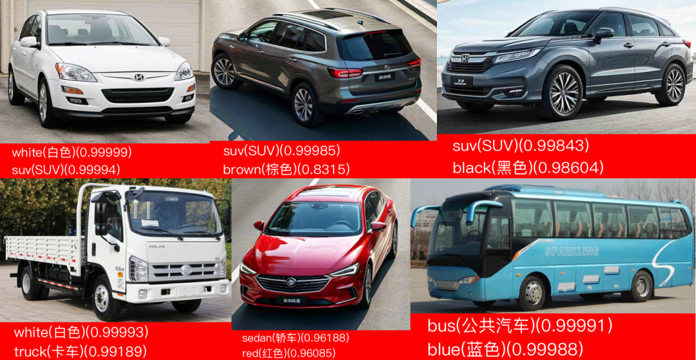
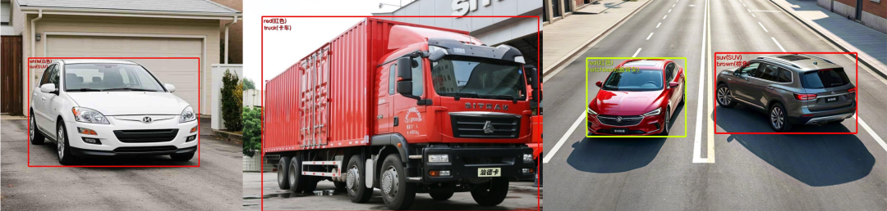

# Issue 003: Training and Inference on VeRi Dataset for Vehicle Attribute Recognition Based on PaddleX and PaddleClas with Ubuntu 22.04 System

```
Test environment:
Ubuntu 22.04.4 LTS
cuda_11.8
Tesla P4 graphics card
500G disk space
```

>

Preview of the final directory structure of project source code



1. Environmental Preparation (Important ⭐⭐⭐)

##### Creating a Virtual Environment

```
# Creating the environment
conda create -n paddleclas python=3.10
# Activation environment entry
conda activate paddleclas
```

##### Install PaddlePaddle

Reference: https://www.paddlepaddle.org.cn/install/quick?docurl=/documentation/docs/zh/develop/install/pip/linux-pip.html

```
# Installation instructions
python -m pip install paddlepaddle-gpu==3.1.1 -i https://www.paddlepaddle.org.cn/packages/stable/cu118/
# Verify if PaddlePaddle is available on GPU
python -c "import paddle;print(paddle.utils.run_check());print(paddle.__version__)"
# Output the following information, then install is successful, paddlepaddle-gpu can be used.
'''
Running verify PaddlePaddle program ... 
I0825 13:43:27.997210  5693 pir_interpreter.cc:1524] New Executor is Running ...
W0825 13:43:27.997584  5693 gpu_resources.cc:114] Please NOTE: device: 0, GPU Compute Capability: 6.1, Driver API Version: 12.4, Runtime API Version: 11.8
I0825 13:43:28.222457  5693 pir_interpreter.cc:1547] pir interpreter is running by multi-thread mode ...
PaddlePaddle works well on 1 GPU.
PaddlePaddle is installed successfully! Let's start deep learning with PaddlePaddle now.
None
3.1.1
'''
```

##### Install PaddleX

Refer to the reference: https://paddlepaddle.github.io/PaddleX/latest/installation/installation.html

```
pip install paddlex==3.1.1 -i https://pypi.tuna.tsinghua.edu.cn/simple
# Installing Optional Dependencies [Required for subsequent pipeline product lines]
pip install "paddlex[cv]==3.1.1" -i https://pypi.tuna.tsinghua.edu.cn/simple
# Additional Dependencies
pip install pypdfium2 -i https://pypi.tuna.tsinghua.edu.cn/simple
```

##### Install PaddleClas Plugin

Refer to the reference: https://paddlepaddle.github.io/PaddleX/latest/installation/installation.html

```
# Access the source code repository (for training purposes, does not conflict with the aforementioned inference library)
git clone -b release/3.1 https://github.com/PaddlePaddle/PaddleX.git 
cd PaddleX
# Source code compilation
pip install -e .
# Install Plugin
paddlex --install PaddleClas
# The installation is successful, and paddlecls can be used.
'''
......
Successfully built paddleclas
Installing collected packages: paddleclas
Successfully installed paddleclas-2.6.0
All packages are installed.
'''
```

2. Data Preparation (Important ⭐⭐⭐)

##### 2.1 Data Download and Production

Official Aistudio data download

Refer to: https://aistudio.baidu.com/datasetdetail/19234

```
# Referenced Download Method
wget -c "https://ai-studio-online.bj.bcebos.com/v1/48bd682fea7949fd8dff2c27008d21f0a2dba988de0f4becb1e2e70cda8ec2c5?responseContentDisposition=attachment%3Bfilename%3DVeRi.zip&authorization=bce-auth-v1%2F5cfe9a5e1454405eb2a975c43eace6ec%2F2025-08-25T03%3A25%3A21Z%2F60%2F%2F380d96abc397783e17cf025b5a9f3ba665952d9ffdef07779365335e5ae48f84"
```

**Create paddle format data** (Placed in the PaddleX source code directory)

The directory structure is:

```
datasets/
└── veri/
    ├── images/
    ├── label.txt
    ├── train.txt
    └── val.txt
```

The content of the `label.txt` file is as follows (**19 categories**):

```
0 yellow(yellow)
1 orange (orange)
2 green
3 Gray
4 red
5 blue(blue)
6 white(white)
7 golden
8 Brown
9 Black
10 sedan (sedan)
11 suv(SUV)
12 van
13 hatchback (saloon)
14 MPV (Multi-Purpose Vehicle)
15 pickup (pickup truck)
16 bus
17 truck
18 estate (transit)
```

The content of the `train.txt` file is as follows (**37,746 entries**):

```
images/0001_c001_00016450_0.jpg 1,0,0,0,0,0,0,0,0,0,0,0,0,1,0,0,0,0,0
images/0001_c001_00016460_0.jpg 1,0,0,0,0,0,0,0,0,0,0,0,0,1,0,0,0,0,0
images/0001_c001_00016470_0.jpg 1,0,0,0,0,0,0,0,0,0,0,0,0,1,0,0,0,0,0
images/0001_c001_00016480_0.jpg 1,0,0,0,0,0,0,0,0,0,0,0,0,1,0,0,0,0,0
images/0001_c001_00016490_0.jpg 1,0,0,0,0,0,0,0,0,0,0,0,0,1,0,0,0,0,0
......
```

The content of the `val.txt` file is as follows (**11579** data):

```
......
images/0776_c007_00000610_0.jpg 0,0,0,0,0,0,0,0,0,1,1,0,0,0,0,0,0,0,0
images/0776_c007_00000620_0.jpg 0,0,0,0,0,0,0,0,0,1,1,0,0,0,0,0,0,0,0
images/0776_c007_00000625_0.jpg 0,0,0,0,0,0,0,0,0,1,1,0,0,0,0,0,0,0,0
images/0776_c007_00000630_0.jpg 0,0,0,0,0,0,0,0,0,1,1,0,0,0,0,0,0,0,0
images/0776_c009_00000000_0.jpg 0,0,0,0,0,0,0,0,0,1,1,0,0,0,0,0,0,0,0
```

The `images/` directory contains all the images, and the statistics are as follows:

```
Total number of JPG images: 49357
Post-duplication resolution statistics:
Resolution (Width x Height)  Occurrences
---------------------------
A total of 31771 different resolutions are available.
```

PS: test.txt is temporarily **not used**.

>

At the end of the article, reply with the corresponding **keyword** to obtain the prepared **paddle format** training dataset.

# 2.2 Data Verification

**Operations in the PaddleX source code directory**

Create a new shell and execute the script `check_data.sh` with the following content:

```
python main.py -c paddlex/configs/modules/vehicle_attribute_recognition/PP-LCNet_x1_0_vehicle_attribute.yaml \
    -o Global.mode=check_dataset \
    -o Global.dataset_dir=./datasets/veri
```

Execute the verification script, output success information

```
# Command line execution
bash check_data.sh
# The following information is output, which indicates the verification is successful. The result content can be seen in the ./output directory.
'''
Connecting to https://paddle-model-ecology.bj.bcebos.com/paddlex/PaddleX3.0/fonts/PingFang-SC-Regular.ttf ...
Downloading PingFang-SC-Regular.ttf ...
[==================================================] 100.00%
Check dataset passed !
'''
```

Data distribution histogram, `histogram.png`



3. Start training (important ⭐⭐⭐)

**Operations in the PaddleX source code directory**

Create a new shell and execute the script `script_run_train.sh` with the following content:

```
python main.py -c paddlex/configs/modules/vehicle_attribute_recognition/PP-LCNet_x1_0_vehicle_attribute.yaml \
    -o Global.mode=train \
    -o Global.dataset_dir=./datasets/veri \
    -o Global.device=gpu:0 \
    -o Train.num_classes=19 \
    -o Train.epochs_iters=300 \
    -o Train.batch_size=128 \
    -o Train.pretrain_weight_path=./pretrain_weight/PP-LCNet_x1_0_vehicle_attribute_pretrained.pdparams \
    -o Train.log_interval=20 \
    -o Train.eval_interval=100 \
    -o Train.save_interval=100
```

###### Details of Training Startup Parameters

|

Parameter name

 ||

Data type

 ||

Description

 ||

Example value

 |

| `mode` ||

str

 ||

Specify the pattern: check_dataset/train/evaluate/export/predict

 || `train` |
| `dataset_dir` ||

str

 ||

Dataset path

 || `./datasets/veri` |
| `device` ||

str

 ||

Specify the equipment to be used

 || `gpu:0` |
| `num_classes` ||

int

 ||

Number of categories in the dataset

 || `19` |
| `epochs_iters` ||

int

 ||

Number of repetitive learnings by the model on the training data

 || `300` |
| `batch_size` ||

int

 ||

Training batch size

 || `128` |
| `pretrain_weight_path` ||

str

 ||

Pre-trained weight path

 || `./pretrain_weight/PP-LCNet_x1_0_vehicle_attribute_pretrained.pdparams` |
| `log_interval` ||

int

 ||

Training log print interval

|| `yaml file specified training log print interval` |
| `eval_interval` ||

int

 ||

Model evaluation interval

`yaml file specified model evaluation interval` |
| `save_interval` ||

int

 ||

Model save interval

`yaml file specified model save interval`

Execute the training script, and the results are stored in the `./output directory`.

```
# Command line execution
bash run_train.sh
```

After the training ends, proceed to the ./output directory for operations.

Visualization metrics output, using the visualdl command

```
# Command line execution
visualdl --logdir ./ --port 8080
Then, enter the address in the local browser: http://localhost:8080/, and you can access it.
```

The example is as follows, see `Indicator Trend Map.png`



4. Begin the assessment (important ⭐⭐⭐)

**Operations in the PaddleX source code directory**

Create a new shell and execute the script `script_run_eval.sh` with the following content:

```
python main.py -c paddlex/configs/modules/vehicle_attribute_recognition/PP-LCNet_x1_0_vehicle_attribute.yaml \
    -o Global.mode=evaluate \
    -o Global.dataset_dir=./datasets/veri \
    -o Evaluate.weight_path=./output/best_model/best_model.pdparams \
    -o Evaluate.log_interval=10
```

PS: When evaluating the model, it is necessary to specify the path of the model weight file.

After the model evaluation, `evaluate_result.json` will be generated in the `./output directory`, which records the results of the evaluation task and the evaluation metrics of the model, including the average precision (ma).

```
{
  "done_flag": true,
  "metrics": {
    "evalres: ma": 0.90695
  }
}
```

5. Starting the reasoning (important ⭐⭐⭐)

**Operations in the PaddleX source code directory**

Create a new shell and run the script `script_run_predict.sh` with the following content:

```
python main.py -c paddlex/configs/modules/vehicle_attribute_recognition/PP-LCNet_x1_0_vehicle_attribute.yaml \
    -o Global.mode=predict \
    -o Predict.model_dir="./output/best_model/inference" \
    -o Predict.input="./test_imgs/test_001.png"
```

PS: When model inference is required, the model weight folder path needs to be specified, including *.pdiparams of the model in inference mode.

After completing the inference and prediction, `test_001_res.json` will be generated in the `./output directory`, which records the `predicted results`. Specifically, it records whether the prediction task was completed normally, as well as the category scores, etc. The recognition result image is shown below.



**(Additional) Model Integration and Inference** [Optional]

Create a new code file named `fast_predict.py` with the following content:

```
from paddlex import create_model
model_dir = "./output/best_model/inference"
model = create_model(model_name="PP-LCNet_x1_0_vehicle_attribute", model_dir=model_dir)
output = model.predict("./test_imgs", batch_size=1)
for res in output:
    res.print(json_format=False)
    res.save_to_img("./fast_preict_output/")
    res.save_to_json("./fast_preict_output/res.json")
```

The results are saved to the `./fast_preict_output` directory.

**(Additional) Product Line Model Integration Inference** [Optional]

Here, combining the `Vehicle Detection Model` + `Vehicle Property Recognition Model`, form a pipeline inference.

**Step 1**: Create a new `line configuration file` named `my_vehicle_attribute_recognition.yaml`, with the following content:

```
pipeline_name: vehicle_attribute_recognition
SubModules:
Detection:
    module_name:object_detection
    model_name:PP-YOLOE-L_vehicle
model_dir: null# Replace with the path of the vehicle detection model weights after fine-tuning, no fine-tuning yet.
    batch_size:1
    threshold:0.5
Classification:
    module_name:multilabel_classification
    model_name:PP-LCNet_x1_0_vehicle_attribute
model_dir:./output/best_model/inference# Replace with the path of the vehicle attribute recognition model weights after fine-tuning
    batch_size:1
    threshold: 0.7
```

**Step 2**: Create a new `code file` named `fast_predict_pipeline.py`, with the following content:

```
from paddlex import create_pipeline
pipeline = create_pipeline(pipeline="./my_vehicle_attribute_recognition.yaml")
output = pipeline.predict("./test_imgs/vehicle_attribute_001.jpg")
for res in output:
res.print() ## Print the predicted structured output
res.save_to_img("./fast_preict_pipeline_output/") ## Save the result visualization image
res.save_to_json("./fast_preict_pipeline_output/") ## Save the structured output of predictions to "./fast_preict_pipeline_output/"
```

The results are saved to the `./fast_preict_pipeline_output` directory, and the result example is as follows:



6. Reference resource links

-

• https://paddlepaddle.github.io/PaddleX/latest/module_usage/tutorials/cv_modules/vehicle_attribute_recognition.html

-

• https://paddlepaddle.github.io/PaddleX/latest/pipeline_usage/tutorials/cv_pipelines/vehicle_attribute_recognition.html

-

• https://paddlepaddle.github.io/PaddleX/latest/module_usage/instructions/config_parameters_common.html

7. Exchange and Learning

Continue to exchange and learn, promoting mutual progress for you and me. Feel free to **reply and contact** below! Wishing you a prosperous future!


## Payment

Here is a pay link on Stripe ( https://buy.stripe.com/3cs8yP7sY87d0vu9AB ). Please contact me lonlonago@foxmail.com after funding $89, and I will send you a complete data files , thank you!


